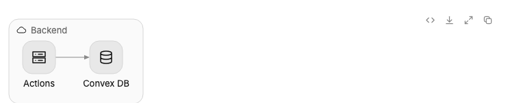
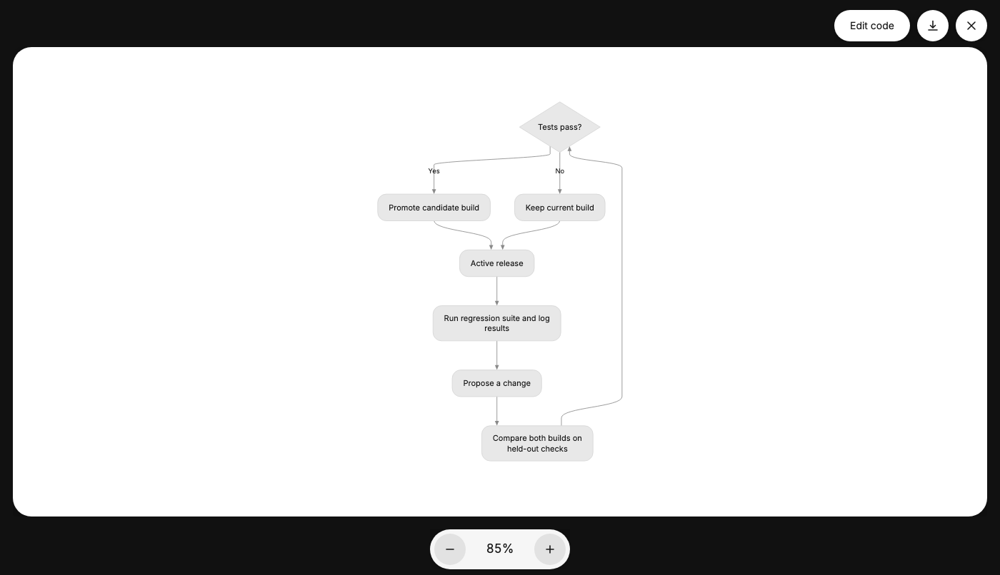
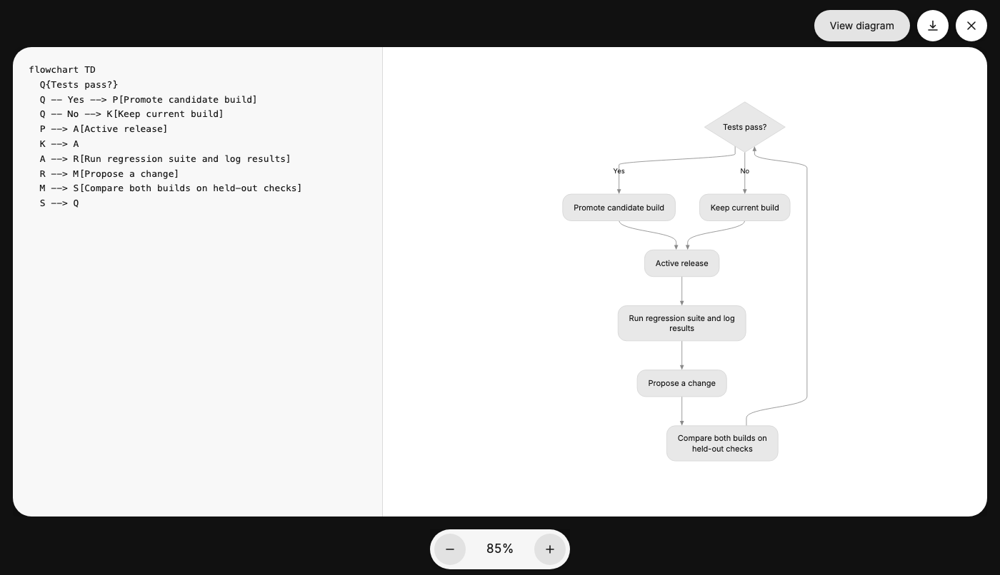

# Mermaid diagrams

A DeepSeek Harness Web plugin that renders Mermaid diagrams **in place**: every
```` ```mermaid ```` code block in Chat is replaced by the rendered diagram, and
the raw code is hidden.

Chat's shared Markdown renderer has no hook for a code fence's language, so a
Slot cannot replace one. The plugin instead watches the page for rendered code
blocks (`.md-code-block`), checks that the code is complete, valid Mermaid, hides
the original block and mounts a diagram card right after it. Disposing the
plugin restores every block.


## What it does

- Replaces valid Mermaid blocks where they appear, in the position the author
  wrote them; other code blocks are untouched.
- Follows streaming: while a reply is being written the card tracks the block and
  updates each time the code is valid Mermaid again.
- Falls back to the plain code block when a diagram cannot be rendered.
- Renders with [Pele](https://pele.run), a small synchronous Mermaid renderer bundled
  into the plugin (offline, no CDN), with a flat
  grayscale theme: light-gray rounded nodes, hairline edges, small arrowheads,
  thin cluster boxes, plus a matching dark palette that follows `theme/change`.
- A chrome-less card with hover tools at the top right: view source, download
  SVG, expand, copy.
- **Expand** opens a full-screen viewer: dark backdrop, white panel, **Edit code**
  (live-editable source with instant preview; an invalid edit keeps the last good
  diagram), download, close, and a zoom pill (− / percent / +; click the percent to
  fit). Also `Esc` to close, `+` / `-` / `0` keys, Ctrl/Cmd+wheel to zoom, drag to pan.
- 40-entry SVG cache keyed by source and color scheme.

English and French copy is registered through the Client locale service.

## Examples

Paste the source of any file in [`examples/`](./examples) into a chat reply inside a
```` ```mermaid ```` fence and it renders in place.

### Diagram in a message

[`examples/architecture.mmd`](./examples/architecture.mmd)

```text
architecture-beta
  group backend(cloud)[Backend]
  service actions(server)[Actions] in backend
  service db(database)[Convex DB] in backend
  actions:R --> L:db
```

The code block above is replaced by the rendered diagram, with no border or header:



Hovering a diagram shows its tools at the top right: view source, download SVG,
expand and copy (visible in the image above).

### Full-screen viewer

**Expand** opens the viewer with **Edit code**, download and close at the top right
and the zoom control at the bottom. This flowchart is
[`examples/flowchart.mmd`](./examples/flowchart.mmd), fitted to the screen:



**Edit code** opens the source next to the diagram, which redraws as you type:



## Layout

| Path | Role |
| --- | --- |
| `index.js` | Host half: contributes the Loader entry only. |
| `cordis.patch.yml` | Bundle patch that inserts the `mermaid-diagrams` row. |
| `src/client.jsx` | Browser half: card, tools, theme wiring, enhancer mount. |
| `src/enhancer.js` | DOM watcher: finds, hides and replaces Mermaid code blocks. |
| `src/viewer.jsx` | Full-screen viewer (zoom, pan, live code editor). |
| `src/viewer-math.js` | Pure zoom and sizing math, unit-tested. |
| `src/renderer.js` | Pele rendering, validation and diagram-type detection. |
| `src/theme.js` | Grayscale `--pele-*` CSS theme, light and dark. |
| `src/mermaid-source.js` | Markdown fence extraction and the diagram-keyword gate. |
| `src/en.js`, `src/fr.js` | Runtime dictionaries. |
| `locale/*.json` | Plugin-inventory title and description. |
| `build.mjs` | Bundles `src/client.jsx` (plus Mermaid) into `client.js`. |
| `test/smoke.mjs` | Offline tests: enhancer against a fake DOM, bundle wiring. |

## Build and test

```bash
npm install
npm run build
npm test
```

## Install into a profile

```bash
git clone https://github.com/svngoku/dsh-mermaid-diagrams.git
cd dsh-mermaid-diagrams
npm install && npm run build   # optional: client.js is already committed
dsh plugin install "$PWD"
```

or install the directory as a bundle through the Harness plugin manager. The
bundle is linked, not copied, so rebuilding `client.js` and restarting the entry
(in the plugin manager, toggle it off and on, or reload the page) serves the new
code.

## Limits

- The replacement is DOM-based because no Slot exists for code fences; it relies
  on the shared code block markup (`.md-code-block`, `[data-code-block-content]`)
  and may need a selector update if that markup changes.
- It applies to every rendered code block in the page, not only Chat.
- Only complete, valid Mermaid is replaced; invalid code stays visible as code.
- `client.js` is ~0.7 MiB because Pele is bundled; it is content-cached by the
  browser after the first load.

## Credits

Diagrams are rendered by [Pele](https://github.com/obsidianmd/pele) (MIT), a small
synchronous Mermaid renderer.

## License

MIT, see [LICENSE](./LICENSE).
